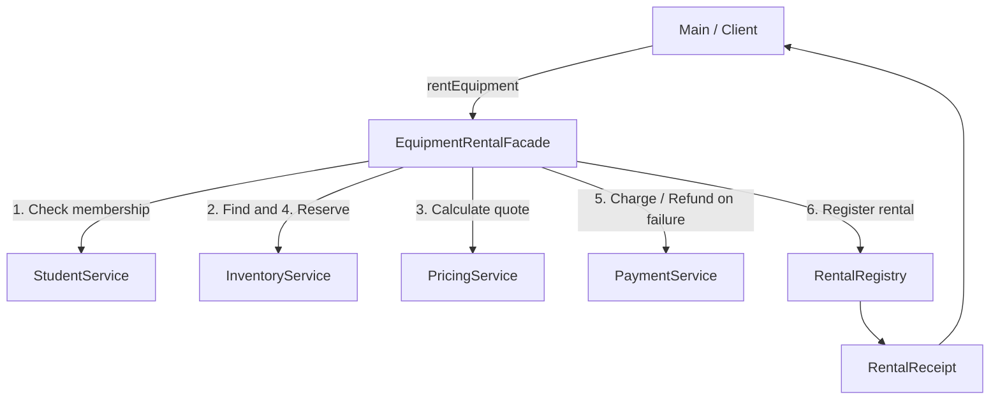

# Assignment #4 — Facade Pattern

**Course:** Software Design Patterns  
**Language:** Java 17+  
**Topic:** Campus Equipment Rental

A student rents campus equipment with one call:

```java
EquipmentRentalFacade facade = new EquipmentRentalFacade();
RentalReceipt receipt = facade.rentEquipment("ST1001", "CAMERA", 3);
```

The facade checks student eligibility, looks up equipment, calculates a price, reserves stock, charges a simulated wallet and registers the rental. If payment or registration fails, it compensates for completed changes in reverse order.

## Run

Install a **JDK 17 or newer** and make `java` and `javac` available on `PATH`. No external libraries, Maven, Gradle or IDE plugins are needed.

```sh
# Linux / macOS
sh run.sh
sh run.sh test
```

```bat
rem Windows
run.bat
run.bat test
```

Manual compilation from the repository root:

```sh
mkdir -p build
javac --release 17 -encoding UTF-8 -Xlint:all -Werror -d build src/com/company/*.java
java -cp build com.company.Main
```

In IntelliJ IDEA, open the project, choose JDK 17+, mark `src` as Sources Root and run `com.company.Main`. Optionally mark `tests` as Test Sources Root and run `com.company.FacadeTests`.

## Pattern participants

| Participant | Class | Responsibility |
| --- | --- | --- |
| Client | `Main` | Creates the facade, requests rentals and displays receipts/errors. |
| Facade | `EquipmentRentalFacade` | Coordinates the workflow through `rentEquipment(studentId, equipmentId, days)`. |
| Subsystem 1 | `StudentService` | Finds a registered student and rejects inactive memberships. |
| Subsystem 2 | `InventoryService` | Owns the catalog, tracks stock and issues/releases reservation tokens. |
| Subsystem 3 | `PricingService` | Validates a 1–14 day duration, calculates fees and applies a weekly discount. |
| Subsystem 4 | `PaymentService` | Checks wallet balances, debits payments and refunds by payment ID. |
| Subsystem 5 | `RentalRegistry` | Assigns rental IDs, calculates due dates and stores immutable receipts. |

`Student`, `Equipment`, `RentalQuote` and `RentalReceipt` are immutable data records. They are not counted as subsystem classes.



The services exchange domain data through the facade: the selected `Equipment` is used by pricing, the resulting `RentalQuote` determines the charge and the registry receives the student, equipment and quote. Each service owns real state or business rules.

## Coordination and error handling

1. Validate the student and find the equipment.
2. Validate the duration and calculate the quote before changing any state.
3. Reserve one available unit and retain its reservation ID.
4. Charge the rental fee plus deposit and retain the payment ID.
5. Register the rental and return its receipt.
6. If a step fails, refund any completed payment, then release any completed reservation.

The client catches one `RentalException`; the original exception remains its cause. A cleanup failure is attached as a suppressed exception so it does not hide the original error or prevent the other cleanup attempt. Refund/release operations are idempotent.

Subsystems have no references to the facade. Their public APIs remain usable directly by an advanced client; `directSubsystemUse` in the test suite demonstrates a complete rental without a facade. The normal application client, `Main`, accesses no subsystem classes. The facade's public interface contains only its no-argument constructor and the rental operation. Package-private dependency wiring is used by tests.

## Clean Code principles and justification

| Principle | Concrete implementation | Why it helps |
| --- | --- | --- |
| Meaningful names | `rentEquipment`, `requireEligible`, `reserve`, `refund` | The caller can understand each operation without reading its body. |
| Single Responsibility | Pricing owns pricing rules; payment owns wallet operations; the facade coordinates. | Rules can change independently without moving business logic into the facade. |
| Small, focused classes | Five services each own a specific part of renting equipment. | Each class is easier to understand and test independently. |
| Encapsulation | Private service fields, immutable result records, copied registry snapshots. | Callers cannot mutate internal stock, balances or stored rentals. |
| Small, simplified API | One facade operation accepts a student ID, equipment ID and number of days. | The client does not know reservation/payment IDs or the order of service calls. |
| Explicit error handling | Compensation, `RentalException`, retained cause and suppressed cleanup errors. | A failed rental does not normally leave reserved stock or deducted money behind. |
| Avoid magic values | Named duration/discount constants and `BigDecimal` money. | Business rules are explicit and currency calculations avoid floating-point errors. |
| Separation of presentation and logic | Only `Main` prints; services return data or raise errors. | Business behavior is testable without inspecting console messages. |

## Demo data and rules

All students, names, balances and inventory are fictional demo data. Wallet operations are simulated; no external payment service is used. Monetary values are in KZT.

| Student | Membership | Initial wallet |
| --- | --- | ---: |
| `ST1001` / Aida | Active | 50,000.00 |
| `ST1002` / Dias | Active | 1,000.00 |
| `ST1003` / Miras | Inactive | 50,000.00 |

| Equipment ID | Initial units | Daily rate | Deposit |
| --- | ---: | ---: | ---: |
| `CAMERA` | 1 | 1,500.00 | 8,000.00 |
| `LAPTOP` | 2 | 2,500.00 | 10,000.00 |
| `PROJECTOR` | 1 | 2,000.00 | 7,000.00 |

The rental duration is 1–14 days. Renting for 7 or more days reduces the rental fee by 10%; the deposit is unchanged. A 3-day camera rental costs `1,500 × 3 + 8,000 = 12,500 KZT`. A 7-day laptop rental costs `2,500 × 7 × 0.90 + 10,000 = 25,750 KZT`. The due date is the current local date plus the number of rental days.

`Main` demonstrates a successful rental, unavailable equipment, payment rejection with released stock, a subsequent successful retry, the weekly discount, inactive membership and an invalid duration. See [sample output](docs/SAMPLE_OUTPUT.txt).

## Verification

`sh run.sh test` compiles both source and tests with Java 17 compatibility, all compiler warnings enabled and warnings treated as errors. Twelve behavioral tests cover successful coordination, prices and boundaries, rounding, rejection without unintended state changes, compensation after payment/registration failures, cleanup error reporting, idempotency, direct subsystem use and immutable registry snapshots. Tests use a fixed clock so due dates are reproducible, and explicit checks work without `-ea`.

## Scope

This is a single-threaded, in-memory assignment application. State resets when a new facade is created or the program restarts. The demo covers checkout; returns, late fees and deposit refunds after a normal return are outside its scope. A successful rental keeps its stock reserved and deposit charged. Compensation assumes that a failing service has not committed a partial operation; the supplied services meet this contract for ordinary application exceptions. It is not a distributed transaction or a persistent payment system.

## Defense

See [the Russian defense guide](docs/DEFENSE_RU.md) for an explanation, walkthrough and likely questions.

The design follows the reference's client → facade → subsystem structure with a different topic and five substantive services. There is no shared `IJob.doJob()` interface: membership checks, pricing, payments and reservations have different inputs and results, so forcing them into one method would hide their actual responsibilities.
